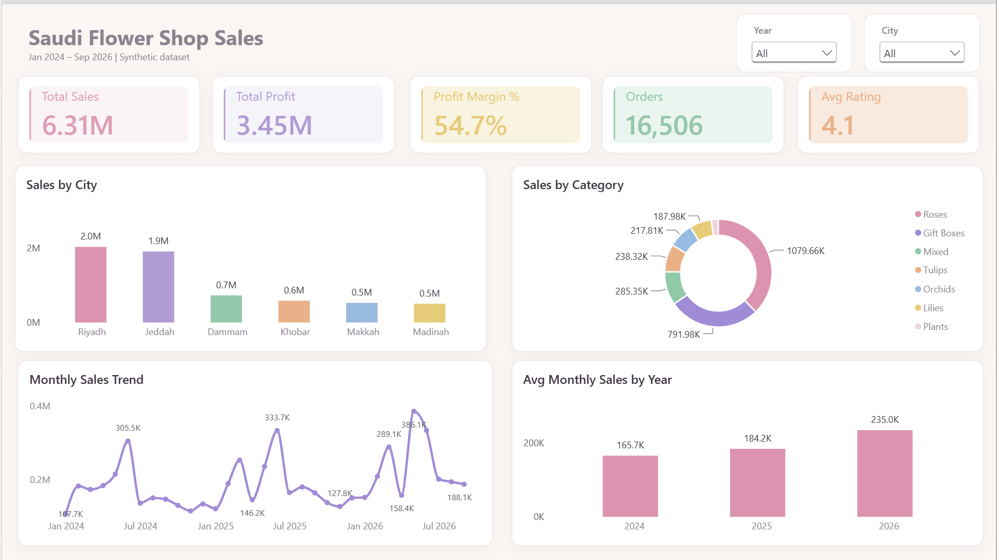
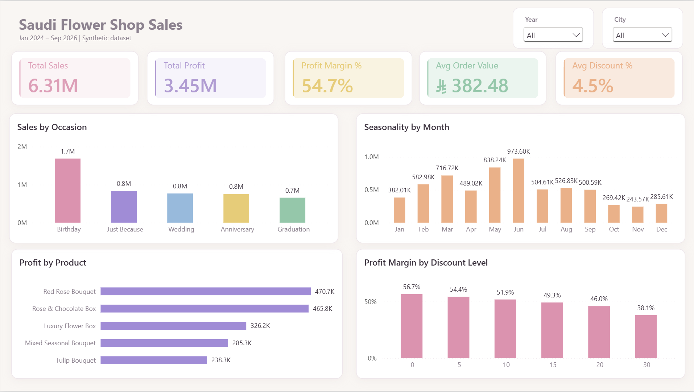
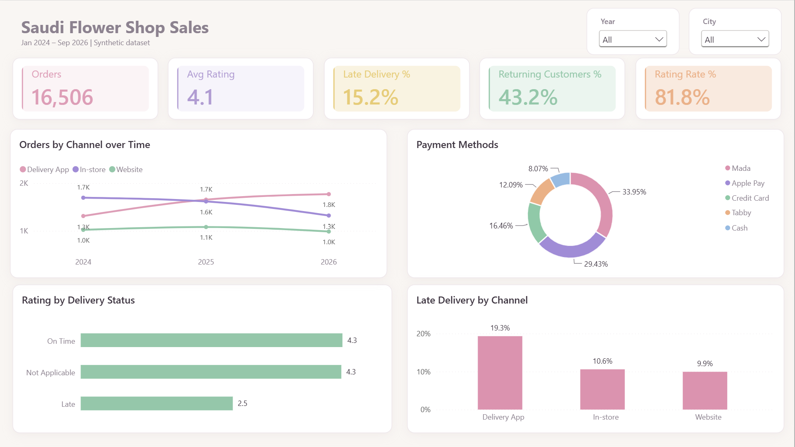

# Saudi Flower Shop Sales Dashboard | Power BI

A Power BI dashboard analyzing **16,506 orders** from a flower shop chain with **10 branches in 6 Saudi cities** (January 2024 – September 2026). It looks at sales growth, seasonality, discounts, sales channels, delivery performance, and customer satisfaction, and ends with clear recommendations for the business.



---

## Business Questions

1. Are sales growing year over year?
2. Which months and occasions drive the most sales?
3. Which products and categories bring the most sales and profit?
4. Do discounts help the business or hurt profit?
5. Which sales channels are growing, and how well do they deliver?
6. What affects customer ratings?

---

## Dataset

**Source:** Synthetic practice dataset built to simulate a real Saudi flower retailer. It was designed with realistic patterns (seasonal peaks, local occasions, Saudi payment methods) and **intentional data quality issues** to practice cleaning and validation.

| Column | Description |
|---|---|
| `order_id` | Unique order number |
| `order_date` | Date of the order |
| `city`, `branch` | Store location (Riyadh, Jeddah, Dammam, Khobar, Makkah, Madinah) |
| `channel` | In-store, Website, Delivery App, WhatsApp |
| `product_category`, `product_name` | Roses, Gift Boxes, Tulips, Orchids, Lilies, Mixed |
| `occasion` | Birthday, Wedding, Graduation, Anniversary, Just Because, and more |
| `quantity`, `unit_price_sar`, `discount_pct` | Order details |
| `cost_sar` | Cost of the order |
| `payment_method` | Mada, Apple Pay, Credit Card, Tabby, Cash |
| `customer_type` | New or Returning |
| `delivery_type`, `delivery_status` | Delivery or Pickup, On Time or Late |
| `rating` | Customer rating from 1 to 5 (optional) |

---

## Data Validation & Cleaning (Power Query)

Every column was profiled (column quality, distribution, and profile on the **entire dataset**) before building any visual. Seven problems were found and fixed:

| # | Problem Found | Fix |
|---|---|---|
| 1 | `channel` had **30 blank values** | Replaced with `Unknown` instead of deleting the orders |
| 2 | `city` had mixed casing and extra spaces (`riyadh`, ` JEDDAH `) | Trim, Clean, and Capitalize Each Word |
| 3 | Same product written two ways (`Red Roses Bouquet` / `Red Rose Bouquet`) | Unified to `Red Rose Bouquet` |
| 4 | **25 negative quantities** while their sales were positive | Converted to absolute value (data entry error) |
| 5 | `total_sar` had **40 outliers about 10× the normal value** | Recalculated `Sales = quantity × unit_price × (1 − discount)` and removed `total_sar` |
| 6 | **6 orders dated in year 2052** | Corrected to 2025 (digit swap, documented as an assumption) |
| 7 | **120 duplicate orders** (same `order_id`) | Removed duplicates: 16,626 → **16,506 rows** |

Two things looked like problems but were **not errors**:

- **Blank `delivery_status` for Pickup orders:** pickup orders are never delivered, so they were labeled `Not Applicable`.
- **18% of orders have no rating:** not every customer rates. Blanks were kept as blanks (not zero) so the average rating stays correct, and a `Rated` (Yes/No) column was added to measure the rating rate.

---

## Data Model & Measures

- A **Date table** (2024–2026) linked to the order date, marked as a date table, with months sorted by month number.
- Key DAX measures:

| Measure | Purpose |
|---|---|
| `Total Sales`, `Total Profit`, `Profit Margin %` | Core financial KPIs |
| `Orders`, `Avg Order Value` | Volume and basket size |
| `Avg Monthly Sales` | Fair year comparison, since 2026 only covers 9 months |
| `Avg Discount %` | Discount level |
| `Late Delivery %` | Late orders out of delivery orders only |
| `Returning Customers %`, `Avg Rating`, `Rating Rate %` | Customer loyalty and satisfaction |

```dax
Avg Monthly Sales = AVERAGEX(VALUES('Date'[Month Start]), [Total Sales])

Late Delivery % =
DIVIDE(
    CALCULATE([Orders], 'saudi_flower_shop_sales'[delivery_status] = "Late"),
    CALCULATE([Orders], 'saudi_flower_shop_sales'[delivery_type] = "Delivery")
)
```

---

## Dashboard Pages

| Page | Focus |
|---|---|
| **Overview** | Sales, profit, margin, orders, rating, yearly growth, monthly trend, cities |
| **Occasions & Products** | Top occasions, categories, most profitable products, seasonality, discount impact |
| **Channels & Customers** | Channel growth, late delivery, ratings, payment methods, returning customers |

| Occasions & Products | Channels & Customers |
|---|---|
|  |  |

---

## Key Numbers

| KPI | Value |
|---|---|
| Total Sales | **6.31M SAR** |
| Total Profit | **3.45M SAR** |
| Profit Margin | **54.7%** |
| Orders | **16,506** |
| Avg Order Value | **382 SAR** |
| Avg Rating | **4.1 / 5** |
| Late Delivery | **15.2%** |
| Returning Customers | **43.2%** |

---

## Key Insights

### 1. The business is growing steadily
Average monthly sales grew from **166K SAR in 2024 to 184K in 2025 and 235K in 2026**, a **42% increase**. Monthly average was used because 2026 only includes January to September, so comparing yearly totals would be misleading.

### 2. June is the peak season
June sales reached **974K SAR, about 4× November (244K)**, driven by graduation season and Eid. Smaller peaks appear every February (Valentine's Day and Founding Day).

### 3. Discounts are eating into profit
Profit margin falls from **56.7% with no discount to 38.1% at a 30% discount**. Large discounts reduce profit much more than they increase sales.

### 4. Delivery apps became the top channel, but they deliver late
In 2024, **In-store** was the top channel. By 2026, **Delivery App** took the lead. However, delivery apps have a **19.3% late rate**, compared with about **10%** for other channels.

### 5. Late delivery is the main reason for low ratings
Orders delivered on time are rated **4.3**, while late orders are rated only **2.5**. Delivery speed has the biggest effect on customer satisfaction.

### 6. What sells the most
- **Roses** are the top category (**1.08M SAR**), followed by Gift Boxes (**792K SAR**).
- **Birthday** is the top occasion (**1.7M SAR**).
- The most profitable products are **Red Rose Bouquet (471K)** and **Rose & Chocolate Box (466K)**.
- **Riyadh (2.0M)** and **Jeddah (1.9M)** bring in over 60% of sales.
- **Mada** is the most used payment method (**34%**), followed by Apple Pay (**29%**).

---

## Recommendations

1. **Renegotiate the delivery app agreement (SLA):** set a maximum delivery time, especially during peak seasons. This is the fastest way to raise ratings in the channel that is growing the most.
2. **Prepare for June from mid-May:** increase stock of roses and gift boxes and add staff before graduation and Eid.
3. **Cap discounts at around 10%:** higher discounts cut margin sharply. Use bundles (such as roses with chocolate) instead of deep discounts.
4. **Focus on Riyadh and Jeddah** for marketing campaigns, since they generate most of the sales.

---

## Limitations

- **Synthetic data:** built for practice, so the results show the analysis method, not a real company's performance.
- **2026 is a partial year** (January to September), so years were compared using average monthly sales.
- The 2052 date fix is an **assumption** (likely a typing error), and it was documented.

---

## Tools & Skills

- **Power BI:** Power Query (profiling, cleaning, custom and conditional columns, removing duplicates), data modeling with a Date table, DAX measures, 3-page report with a custom pastel theme
- **Data validation:** finding and fixing blanks, inconsistent text, negative values, outliers, wrong dates, and duplicates
- **Analysis:** growth and seasonality analysis, discount impact on margin, channel and delivery performance, turning insights into recommendations

---

## Repository Structure

```
├── Saudi_Flower_Shop_Sales.pbix
├── README.md
├── data/
│   └── saudi_flower_shop_sales.csv
└── screenshots/
    ├── overview.png
    ├── occasions_products.png
    └── channels_customers.png
```

---

**Author:** Razan Albishri · [LinkedIn](https://www.linkedin.com/in/razan-albishri)
